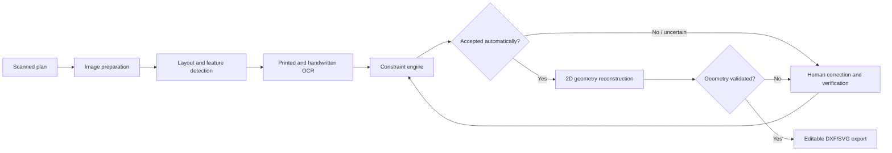

# Planline architecture

Planline converts a scanned house plan into a reviewed, editable **2D** vector/CAD floor plan. It is a local-first system: source scans, annotations, model outputs, and exports stay on the workstation unless a future deployment is deliberately configured otherwise.

## Product rule

The system measures success by correction time and resulting geometry, not by a single OCR percentage. A value that does not meet the acceptance rules remains uncertain and must be reviewed; it never silently becomes CAD geometry.

## Components

| Component | Responsibility | Current state |
| --- | --- | --- |
| Web UI | Source preview, uncertainty review, manual correction, chain checks, 2D preview and export controls | Implemented in `web/`; sample project is interactive |
| Local API | Project/file storage, job state, review persistence, source retrieval and guarded export | Implemented in `backend/`; source preflight only, no analyser attached |
| Image preparation | Deskewing, denoising, contrast normalisation, page/frame detection and tiling | Planned |
| Detection | Locate walls, openings, symbols, dimension strings/lines, notes and title-block regions | Planned model adapter |
| OCR ensemble | Printed text, handwritten numeric text and annotation recognition | Planned model adapters |
| Constraint engine | Link dimensions to geometry, check chains/overalls, surface conflicts and rank hypotheses | Planned |
| Reconstruction | Produce constrained 2D walls/openings and editable topology | Planned |
| CAD export | Produce DXF/SVG from *verified* geometry | Sample DXF only; production export planned |
| Training workspace | Dataset manifests, annotation QA, experiments, evaluation and model registry | Planned; isolated from the API/UI |

## Pipeline and review gates



### Acceptance rules

1. Every OCR candidate carries model provenance, a confidence score, source region, orientation, and alternatives where available.
2. Printed and handwritten recognition remain separate inputs. They may agree on a value, but one does not overwrite the other.
3. A dimension is auto-accepted only if the OCR policy **and** geometric/dimension-chain checks pass. Thresholds are configurable per model and drawing type.
4. A dimension-chain mismatch, ambiguous association, missing overall dimension, or conflict with inferred geometry creates a review item.
5. Geometry is exportable only when its referenced measurements are verified and topology/constraint validation succeeds.
6. Confidence is not accuracy. Evaluation uses exact dimension-value accuracy, chain consistency, wall/opening topology, export correctness, and median human correction time.

## Data contract between pipeline and UI

The analyser will add the following fields to a project record. These fields are the interface boundary: the UI does not call a model directly.

```json
{
  "analysis": {
    "state": "review_required",
    "stages": [
      {"name": "preprocess", "state": "complete"},
      {"name": "detect", "state": "complete", "model": "detector@v1"},
      {"name": "ocr", "state": "complete", "models": ["printed-ocr@v1", "handwritten-numerals@v1"]},
      {"name": "constraints", "state": "review_required"}
    ]
  },
  "measurements": [
    {
      "id": "dim-01",
      "kind": "dimension",
      "value_mm": 3000,
      "verified": false,
      "confidence": 0.93,
      "provenance": {"model": "handwritten-numerals@v1", "region": [120, 44, 92, 28]},
      "alternatives": [{"value_mm": 8000, "confidence": 0.04}],
      "constraint_status": "chain_mismatch"
    }
  ],
  "geometry": {
    "state": "review_required",
    "walls": [],
    "openings": [],
    "validation": {"connected": false, "issues": ["unresolved dimension chain"]}
  }
}
```

The current API stores uploads locally and runs deterministic source preflight (SHA-256 fingerprint, available image dimensions, and basic input-quality notes). It returns an `analysis.state` of `blocked` because the model adapters that would create dimension readings and geometry are not installed. The frontend hides sample readings whenever a real drawing is loaded.

## OCR and training strategy

- Start with **dimension numerals**, not general-purpose English OCR. The first useful OCR task is reading printed and handwritten numbers attached to dimension annotations; general notes, room labels and title-block text are deferred until they provide measurable value.
- Benchmark printed numerals, handwritten numerals and architectural-feature detection independently. Keep each model output, source crop, confidence and alternatives distinct.
- Use geometry and dimension context to rank numeric candidates, but never let a contextual guess silently replace the source reading.
- Begin with pretrained compact models and fine-tune only after a baseline evaluation on representative scans. Employer/draftsman drawings require documented permission, a data manifest, and annotation rules before use.
- Generate synthetic examples from vector plans where exact geometry and dimension labels are known. Use them to broaden layouts, scan degradation and dimension-chain cases; do not rely on synthetic handwriting as the sole handwriting source.
- Combine licensed real plans with synthetic examples, preserving train/validation/test separation by source plan rather than by crop.
- Use the RTX 2080 Ti (11 GB VRAM) as the local target. Start with compact detector/OCR variants, mixed precision inference, conservative batch sizes, tiled high-resolution inference, and staged fine-tuning rather than large end-to-end models.

## Development plan

### Existing baseline — kept separate from Planline

The root-level `main.py`, `detection.py`, `ocr.py`, `model.py` and `dxf_export.py` are an earlier experimental pipeline: YOLO detects three classes (`wall`, `dimension_line`, `dimension_value`), a custom ResNet18 classifies handwritten digits, and heuristic matching produces a DXF. This pipeline is **not called by the Planline API** and has not been established as reliable on arbitrary scanned or non-scale plans. Treat it as a baseline to evaluate, not as the current web-app analyser.

### Phase 0 — Baseline and data governance

1. Audit the existing detector/OCR/DXF baseline for reusable ideas, model licences, assumptions and code quality. Evaluate its training data and accuracy independently before connecting or reusing it.
2. Create a dataset register covering source, licence, permission, drawing type, scan quality and split assignment. Use only plans with clear permission/licensing.
3. Define annotation guidelines for walls, openings, dimension strings, direction/orientation, overall dimensions, chains, notes and review outcomes.
4. Establish a representative held-out evaluation set before choosing or fine-tuning models.

### Phase 1 — Usable ingestion and review

1. Implement scan preparation and persist its artifacts.
2. Add backend job records and progress events for the UI.
3. Replace sample review rows only when a real analyser returns candidate measurements.
4. Persist edits, verification, alternatives and audit history through the API.

### Phase 2 — Baseline models

1. Benchmark pretrained printed OCR, handwritten-number OCR and feature detection on the held-out plans.
2. Measure exact dimension accuracy, review rate, chain consistency and correction time.
3. Integrate the best baseline as versioned local adapters; retain crops and predictions for inspection.

### Phase 3 — Constraints and 2D reconstruction

1. Associate dimension candidates with dimension lines/walls using spatial relations and orientation.
2. Solve chain and overall constraints as hypotheses, exposing conflicts and alternatives.
3. Generate 2D walls/openings with validation for connectivity, overlaps and unsupported assumptions.
4. Permit export only after all blocking issues are resolved.

### Phase 4 — Fine-tuning and production readiness

1. Fine-tune on licensed real annotations and targeted synthetic augmentation.
2. Compare every candidate model against the fixed held-out set and correction-time target.
3. Add regression cases for faded scans, skew, low resolution, handwritten/printed mixtures and non-scale drawings.
4. Version models, datasets, prompts/configuration and evaluation reports so results remain reproducible.

## Out of scope

Planline produces 2D geometry only. It does not infer a 3D building model or silently fill missing information.


## Product boundary

Planline is a **2D digitisation and verification** tool, not a 3D building generator. For non-scale drawings, written dimensions are the primary metric constraints; pixel distances are not treated as real-world measurements unless a valid scale or calibration is available. The system should expose conflicts and missing information instead of silently stretching, closing or inventing walls.

The first OCR milestone is deliberately narrow: recognise dimension numbers and relevant numeric annotations. Broad English text recognition is not a first-stage dependency. The longer-term training workspace will compare models on a held-out set using exact numeric accuracy, dimension-to-segment association, chain consistency, topology/export correctness and human correction time.
