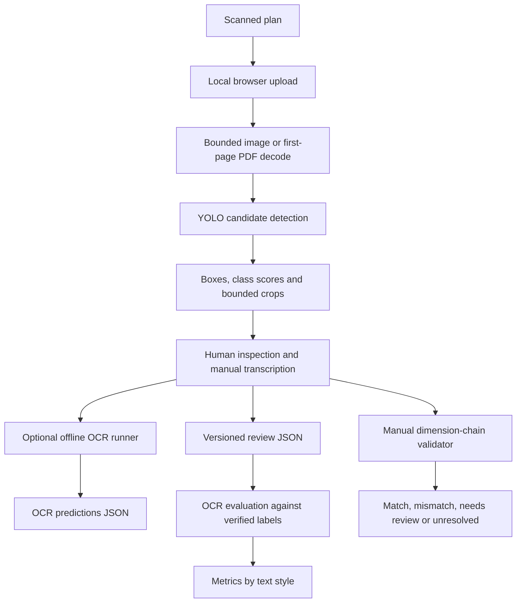

# Planline architecture

## Product boundary

Planline is a **2D scanned-drawing digitisation and verification** project. The intended output is editable 2D vector/CAD geometry, not a 3D building model.

Scanned plans may be rotated, skewed, faded, low-resolution or drawn approximately rather than to scale. Pixel coordinates describe image-space evidence; they are not physical measurements. Written dimensions, once correctly read and associated with the correct span, are the authority for metric geometry.

A value that is unreadable, ambiguous, unassociated, contradictory or insufficient to constrain the plan must remain unresolved and be presented for review. Do not silently invent dimensions or close gaps by visual guesswork.

## Current implementation

The active application is served from the root web/ directory by the local FastAPI service in planline/api.py.

| Component | Current state |
| --- | --- |
| Browser workspace | Implemented: source preview, detector overlay, zoom, threshold control, class filter, detection selection and review crops |
| Upload/decode | Implemented for raster files and first-page PDF rasterisation, with file-size and pixel limits |
| Feature detection | Implemented: bundled YOLO weights produce candidate wall, dimension-line and dimension-value regions |
| Candidate review export | Implemented: versioned JSON schema with source metadata, boxes, class scores and review transcriptions |
| Manual dimension transcription | Implemented as reviewer-entered text associated with a detector candidate; this is not OCR |
| Dimension-chain arithmetic | Implemented as a separate API endpoint for explicit values, verification flags, units and tolerance |
| OCR runner | Optional standalone PaddleOCR crop recogniser; not wired into the web analysis endpoint |
| OCR evaluation | Implemented for review exports and curated crop datasets; dataset mode scores the held-out split by default |
| Dataset inference | Optional PaddleOCR runner can recognise crops from a validated local manifest |
| Handwriting crop curation | Implemented as a local CLI for verified review crops or manually cropped images, manifest validation and source/writer-grouped splits |
| Dimension association | Uses local parallel-wall gaps, value/line alignment, facing wall-box edges, and global one-to-one text-to-line assignment; explicit human confirmation required |
| Metric reconstruction | Not implemented |
| Verified CAD export | Not implemented in the web application |

The old command-line pipeline (main.py, model.py, ocr.py, dxf_export.py) remains separate. It is an experimental baseline and is not invoked by the Planline API.

## Current data flow

The local planline.dataset utility can take the verified review labels and source crop coordinates and prepare a separate OCR dataset. It can also import manually cropped images with a CSV label manifest. It validates image checksums and keeps samples sharing either a source drawing or writer in one train/validation/test split. This is dataset curation only; it does not train a recogniser.

The current data flow now includes a geometric association review stage inspired by the legacy CLI gap model. For each axis-aligned dimension line, it finds parallel wall boxes intersecting a local perpendicular corridor, forms candidate gaps between their facing edges, and scores the text centre, line centre, projected overlap and endpoint fit. It retains wider wall-pair alternatives for overall dimensions, with a penalty for intervening walls. A Hungarian maximum-weight assignment recommends at most one dimension-line detection per text detection; this is a conflict-resolution hint, not a verified association. Scores are relative geometric-fit rankings, rotated/diagonal geometry is not handled, and a reviewer must explicitly confirm both links. The legacy broad image-relative snap radius, pixel-scale averaging fallback and automatic endpoint closure are deliberately not reused. The dimension-chain validator remains a separate arithmetic check and does not infer values or construct geometry.

## Target processing architecture

1. **Ingest and prepare.** Preserve source identity and original coordinates. Correct rotation/skew, inspect scan quality, normalise contrast and rasterise each selected PDF page.
2. **Detect primitives and annotation regions.** Locate walls, openings, dimension lines, arrowheads, dimension strings, symbols and relevant notes. Preserve candidate provenance and source-space coordinates.
3. **Recognise complete dimension strings.** Compare printed and handwritten numeric recognisers on the same crops. Keep raw text, alternatives, confidence and model version separate. Avoid making broad English OCR a prerequisite for the first milestone.
4. **Associate annotations.** Link each recognised value to a dimension line and then to the measured span using orientation, endpoints, extension lines, spatial context and competing hypotheses. Retain multiple candidates when association is ambiguous.
5. **Solve constraints.** Represent written dimensions and dimension chains as explicit constraints. Compare segment sums with overall dimensions, handle tolerances and units deliberately, and report under-constrained or contradictory systems rather than forcing a solution.
6. **Reconstruct 2D topology.** Build editable wall/opening geometry from reviewed constraints. Validate endpoint junctions, connectivity, overlaps, closed boundaries and residuals against known dimensions.
7. **Gate export.** Export DXF/SVG only after referenced measurements are verified and geometry validation passes. Preserve units, layers, source links and review provenance.

## Numeric-first OCR strategy

The first OCR target is dimension numerals and numeric annotations, not every English word on the page. Room names, title blocks and general notes can be deferred until there is an evaluated reason to include them.

The optional PaddleOCR runner provides a recognition-only baseline on review crops and curated dataset images. The evaluator can score review-export detection IDs or dataset crop IDs; curated-dataset evaluation defaults to the source/writer-grouped held-out test split. Output remains raw and unverified until a person checks it. Compare it with other compact printed-numeral and handwriting recognisers on the same held-out crops. Do not allow contextual reasoning to silently overwrite the characters read from the source image.

## Data and evaluation

Use only plans that are owned, licensed or explicitly permitted for the intended use. Maintain source manifests and annotation guidelines. The local dataset CLI writes verified full-string crops to an ignored datasets/ directory, preserves exact text labels, source IDs, optional pseudonymous writer IDs and checksums, and creates group-safe splits. It supports both Planline review exports and manually cropped images supplied through CSV. This establishes a curation path before any model-training decision. Split training, validation and test sets by original drawing (and writer for handwriting), not by individual crops, to prevent source leakage.

Measure the whole task rather than a single OCR score:

- Exact complete-dimension accuracy and prediction coverage.
- Character/number error rate, including decimal separators and units.
- Dimension-line-to-span association accuracy.
- Dimension-chain consistency and unresolved-case detection.
- Geometry connectivity, topology and metric residuals.
- DXF correctness in an independent CAD reader.
- Human correction rate and median time per drawing.

## Local compute

The initial local target is an RTX 2080 Ti with 11 GB VRAM. Start with compact models, high-resolution crops/overlapping tiles where needed, conservative inference batches and staged processing. Choose models from representative-plan evaluation rather than generic benchmark claims.

## Development phases

1. **Baseline and data governance:** inspect the current YOLO and legacy digit models, prepare permissioned representative scans, define annotation rules and a fixed held-out set.
2. **Ingestion and review:** improve source preparation, preserve source/crop coordinates and make manual review/export traceable.
3. **Numeric recognition:** benchmark printed and handwritten dimension OCR separately and record raw hypotheses.
4. **Association and constraints:** associate text with dimension graphics and measured spans; surface chain contradictions and unresolved dimensions.
5. **2D reconstruction:** create editable wall/opening topology with validation and correction tools.
6. **Verified export:** add DXF/SVG only after geometry and dimension gates are testable.
7. **Training workspace:** add reproducible datasets, experiments, model versioning and regression evaluation after data rights and baseline annotations are established. The initial local crop curation/validation CLI is implemented; model training remains future work.

See [PLANLINE_ARCHITECTURE.md](PLANLINE_ARCHITECTURE.md) for the more detailed research notes, risk analysis, OCR comparisons and engineering backlog.
